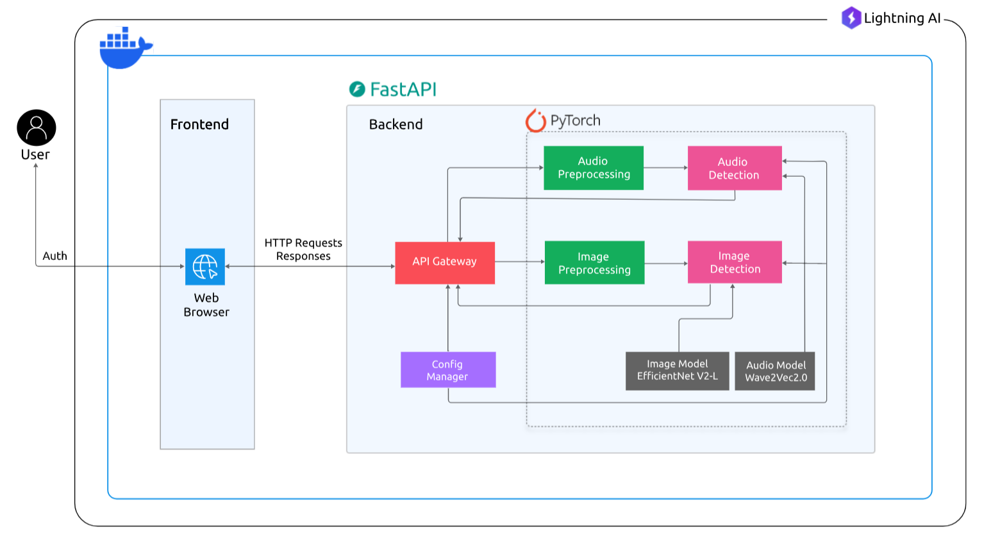

## Detección Multimodal de Deepfakes

[](https://www.python.org/downloads/)
[](LICENSE)

Una aplicación web robusta para detectar medios sintéticos (deepfakes) en **imágenes y audio** utilizando modelos de IA de última generación como **EfficientNetV2** y **Wav2Vec2**. La plataforma ofrece una interfaz intuitiva para el análisis de medios mientras mantiene altos estándares de seguridad y privacidad.

## Demostración en Vivo


## Características Principales

- **Análisis Avanzado de Medios**: Detecta contenido manipulado en múltiples formatos (imágenes, audio)
- **Modelos de IA de Alto Rendimiento**: 
  - **EfficientNetV2** para la detección de falsificaciones en imágenes
  - **Wav2Vec2** para detectar artefactos de síntesis de voz en audio
- **Interfaz Amigable**: Carga de medios arrastrando y soltando con detección instantánea de deepfakes

## Descripción General de la Arquitectura

La aplicación integra modelos de IA de vanguardia con un frontend web limpio.

### Formatos Compatibles

- **Imágenes**: JPG, PNG
- **Audio**: MP3, WAV

### Modelos de Detección

- **Imagen**: **EfficientNetV2** ajustado, entrenado para detectar rastros visuales de deepfakes
- **Audio**: Modelo **Wav2Vec2** ajustado, optimizado para detectar voces sintéticas
- **Procesamiento por Lotes**: Evaluación simultánea de múltiples archivos multimedia

### Diagrama de Arquitectura del Sistema




## Estructura del Proyecto

```
.
├── app/
│   ├── __init__.py
│   ├── audio_detection.py       # Detección de deepfakes de audio basada en Wav2Vec2
│   ├── config.py                # Configuración de la aplicación y rutas del entorno
│   ├── image_detection.py       # Detección de imágenes basada en EfficientNetV2
│   └── main.py                  # Punto de entrada del backend FastAPI
│
├── config.yaml                  # Rutas a modelos y valores de configuración
│
├── data/
│   └── test_data/               # Archivos multimedia de ejemplo (audio/imágen)
│
├── models/
│   ├── audio_model/             # Archivos del modelo Wav2Vec2
│   │   ├── config.json
│   │   ├── model.safetensors
│   │   ├── preprocessor_config.json
│   │   ├── special_tokens_map.json
│   │   ├── tokenizer_config.json
│   │   └── vocab.json
│   │
│   └── image_model/
│       └── EfficientNetV2_model.pth  # Pesos preentrenados de EfficientNetV2
│
├── notebook/
│   ├── audio_detection/
│   │   └── model_train_5.0.ipynb      # Cuaderno de entrenamiento del modelo de audio
│   │
│   └── image_detection/
│       ├── image_data_download.ipynb
│       ├── image_deepfake_detection.ipynb
│       ├── image_detection_dataset.py
│       └── model_training.py
│
├── templates/
│   ├── index.html
│   ├── upload.html
│   └── static/
│       ├── css/
│       │   └── styles.css
│       └── js/
│           └── script.js
│
├── test/
│   ├── deepfakes/
│   └── real/
│
├── pyproject.toml               # Dependencias del proyecto Python
├── README.md                    # Documentación del proyecto
└── uv.lock                      # Archivo de bloqueo para dependencias
```

## Requisitos

- Python 3.10+
- Dependencias de `pyproject.toml`
- FFmpeg (para preprocesamiento de audio)
- Modelos entrenados para imagen y audio (incluidos en `models/`)

## Guía de Instalación

### 1. Clonar el Repositorio

```bash
https://github.com/Akshayredekar07/Multimodal-Deepfake-Detection.git
cd Multimodal-Deepfake-Detection/backend
```

### 2. Crear y Activar Entorno Virtual

```bash
python -m venv venv
source venv/bin/activate  # En Windows: venv\Scripts\activate
```

### 3. Instalar Dependencias

```bash
# Preferido
uv sync

# O usando pip
pip install -r requirements.txt
```

### 4. Verificación de Modelos

Asegúrese de que estos modelos estén presentes:

* `models/audio_model/` (archivos del modelo Wav2Vec2)
* `models/image_model/EfficientnetV2_model.pth`

Verifique también las rutas en `config.yaml`.

### 5. Ejecutar la Aplicación Web

```bash
python -m app.main:app
```

Visite: [http://localhost:8000](http://localhost:8000)

## Configuración de Docker

También puede ejecutar la aplicación usando Docker para un entorno consistente.

### 1. Construir la Imagen de Docker

Asegúrese de estar en el directorio raíz del proyecto (donde se encuentra `backend/`) y ejecute:

```bash
docker build -t mdfd-app .
```

### 2. Ejecutar el Contenedor de Docker

```bash
docker compose up -d
```

### 3. Acceder a la Aplicación

Visite [http://localhost:8000](http://localhost:8000) para usar la aplicación web.

### Notas

- La imagen de Docker utiliza `uvicorn` para ejecutar la aplicación FastAPI.
- Asegúrese de tener Docker instalado en su sistema.
- Si necesita persistir los datos cargados, considere montar un volumen para `/app/data/uploads` (por ejemplo, agregue `-v ./data/uploads:/app/data/uploads` al comando `docker run`).

## Instrucciones de Uso

1. **Página de inicio**: Aprenda cómo funciona la plataforma
2. **Cargar Medios**: Use la página de carga para enviar archivos JPG/PNG o MP3/WAV
3. **Resultados de Detección**:
   * Clasificación: Real o Falso
   * Puntaje de Confianza
   * Si es posible, visualización de anomalías
4. **Seguridad**: Sus archivos multimedia se eliminan inmediatamente después de la detección

## Guía de Desarrollo

### Backend (FastAPI)

* `app/main.py`: Rutas y puntos finales
* `app/image_detection.py`: Lógica de clasificación de imágenes con EfficientNetV2
* `app/audio_detection.py`: Clasificación de audio basada en Wav2Vec2
* `config.yaml`: Establecer rutas a modelos e hiperparámetros

### Frontend

* HTML: `templates/*.html`
* CSS: `templates/static/css/styles.css`
* JavaScript: `templates/static/js/script.js`

### Entrenamiento y Cuadernos

* Audio: `notebook/audio_detection/model_train_5.0.ipynb`
* Imagen: `notebook/image_detection/model_training.py`

## Pruebas

Use los archivos de ejemplo en la carpeta `test/` para verificar la salida.

* `test/deepfakes/`: Ejemplos falsos
* `test/real/`: Ejemplos de archivos genuinos

## Contribuir

1. Haga un fork del repositorio
2. Cree una nueva rama: `git checkout -b feature-name`
3. Realice commit de sus cambios
4. Realice push y envíe una PR

## Licencia

Este proyecto está bajo la [Licencia MIT](LICENSE).

## Contacto

Para ayuda o sugerencias:

* Abra un issue en el repositorio de GitHub
* Envíe un correo al mantenedor: `akshayredekar04@gmail.com`
